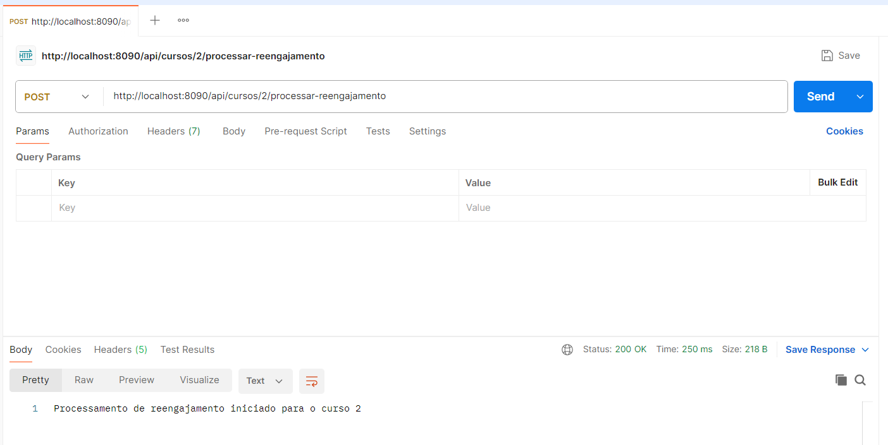
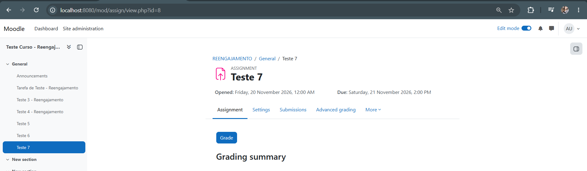
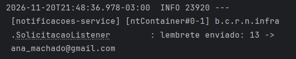
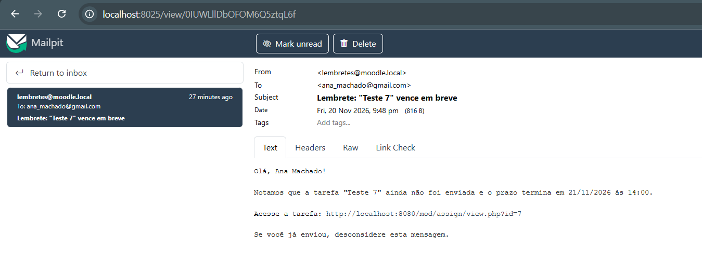
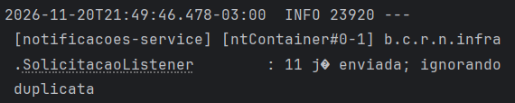

# Testes

### Chamada ao endpoint de reengajamento

### Criada tarefa com menos de 24 horas
---
### Log de consumo e email enviado

### O Email foi enviado com o nome da atividade correto

### O Email foi enviado com o nome da atividade correto

### Após a chamada do endpoint novamente, o serviço consumidor verificou que a mensagem já havia sido enviada, conforme log
