# Registro dos testes — notificacoes-service

Ambiente: Docker Compose (RabbitMQ 3.13, Mailpit, notificacoes-service). Dados fictícios (contas `@aluno.test`).
Data de execução: 20/11/2026. Mensagens publicadas manualmente na fila `reengajamento.solicitacoes`.

## 1. Testes automatizados (`./gradlew test`)

| Critério | Teste |
|---|---|
| Envia e registra | `ProcessadorSolicitacaoTest.enviaLembreteERegistraResultado` |
| CA3 – reprocessar não reenvia | `ca3_reprocessarSolicitacaoConcluidaNaoReenvia`, `alunosDiferentesNaoSeAfetam` |
| CA4 – falha registrada e nova tentativa | `ca4_falhaERegistradaEGeraNovaTentativa` |
| CA4 – tentativas esgotadas | `ca4_tentativasEsgotadasViramFalhaDefinitiva` |
| CA1 – e-mail com nome da tarefa, prazo e link | `SolicitacaoEMensagemTest.emailTemNomeDaTarefaPrazoELink` |
| Validação do contrato | `camposObrigatoriosSaoValidados` |

Resultado: BUILD SUCCESSFUL

## 2. Testes ponta a ponta

| # | Passo | Esperado | Resultado |
|---|---|---|---|
| N1 | Publicar a solicitação `2:1:11` (Ana) | 1 e-mail com tarefa, prazo e link; registro `ENVIADA` | **OK** |
| N2 | Publicar `2:1:11` novamente | Nenhum e-mail novo (idempotência) | **OK** |
| N3 | Parar o Mailpit e publicar `2:1:13` (Carla) | Falha registrada como `PENDENTE` (tentativa 1) e mensagem na fila de retry | **OK** |
| N4 | Parar o Mailpit, publicar `2:1:15` (Eva) e religar o Mailpit | Nova tentativa automática e e-mail entregue | **OK** — `ENVIADA` na 3ª tentativa |
| N5 | Manter o Mailpit parado para `2:1:13` e `2:1:14` (Davi) | Após 3 tentativas: `FALHA` e mensagem em `reengajamento.falhas` | **OK** |
| N6 | Publicar JSON inválido | Mensagem em `reengajamento.falhas`, serviço continua | Não executado |
| N7 | Reiniciar o serviço e republicar `2:1:11` | Registro persistido, sem reenvio | Não executado |

### Evidências

**N1 — e-mail recebido e registro**

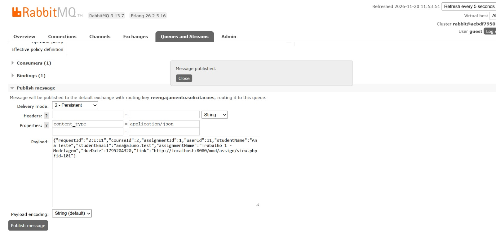
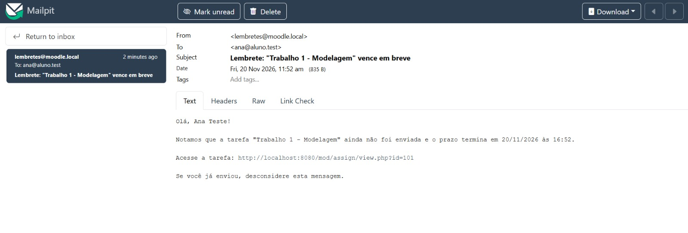

**N2 — sem reenvio de duplicata**

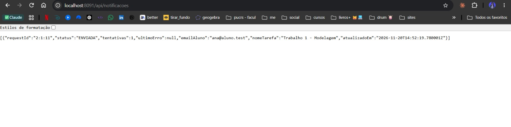

**N3 — falha registrada como PENDENTE e fila de retry**

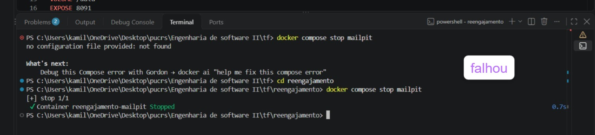
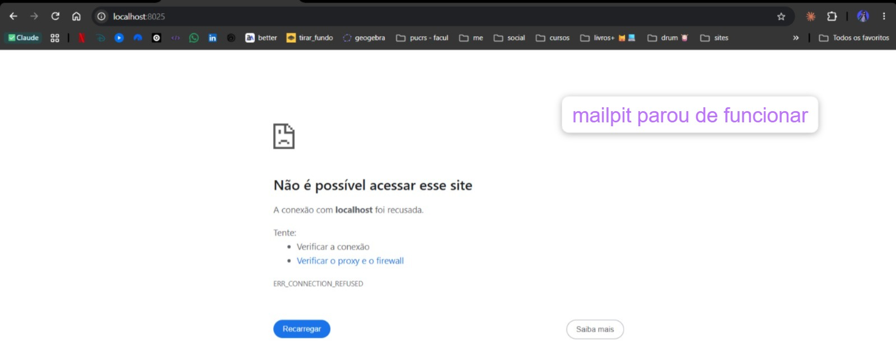
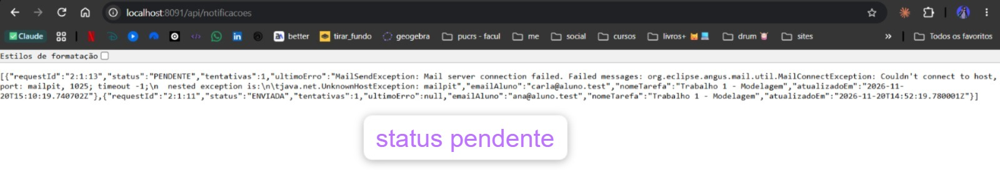
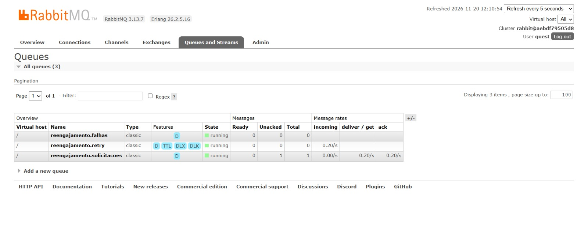

**N4 — nova tentativa com sucesso após o Mailpit voltar**

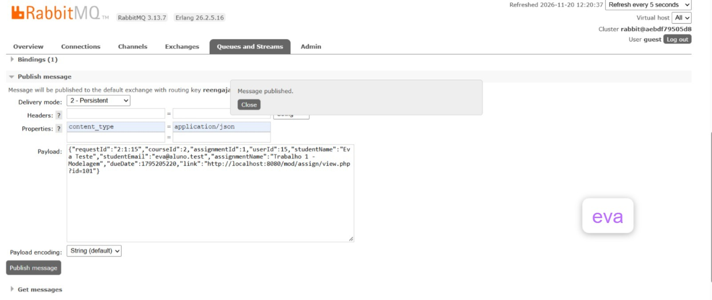
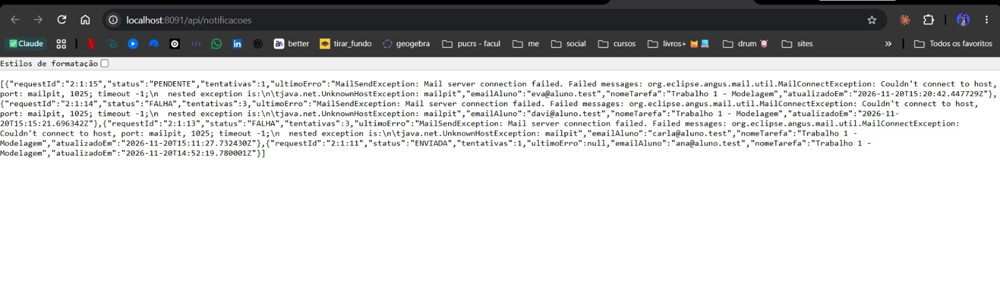
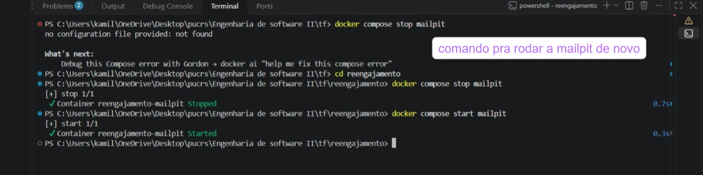
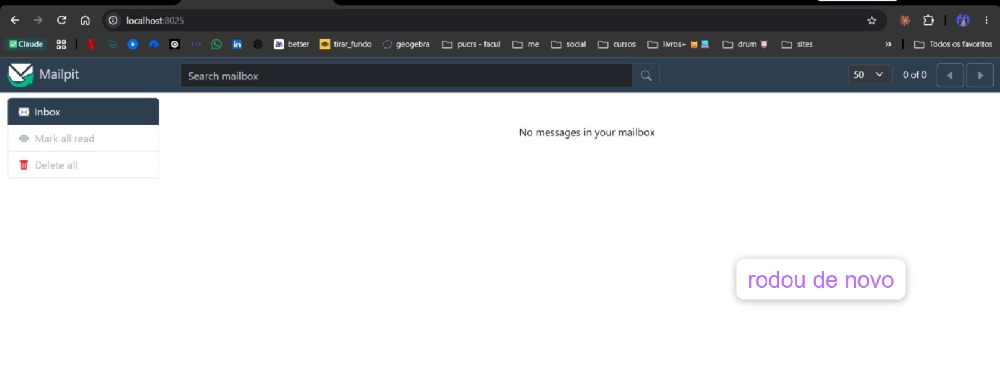
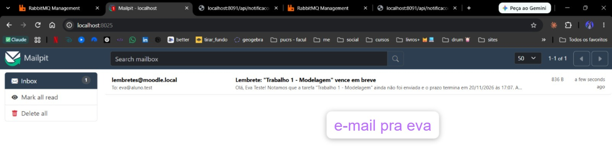
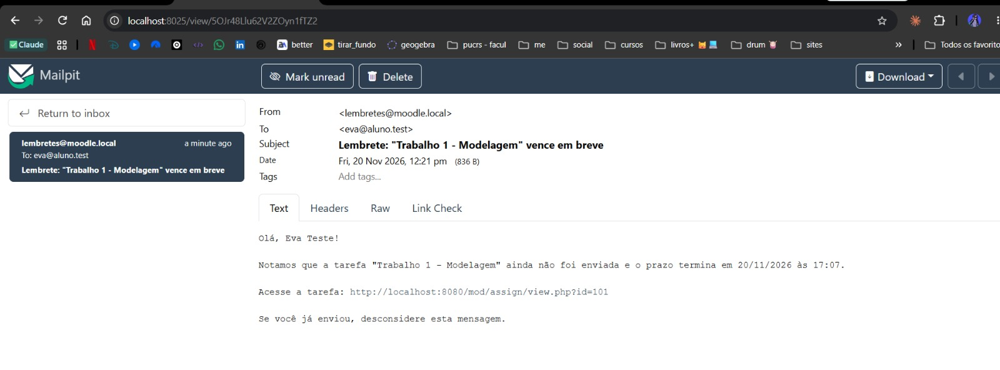
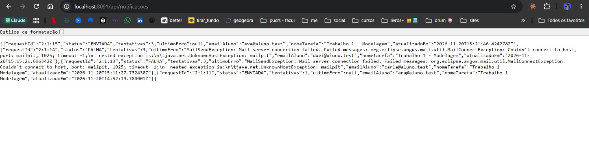

**N5 — tentativas esgotadas**

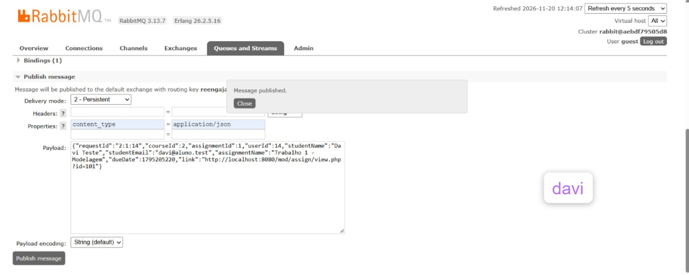
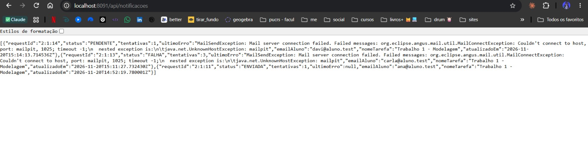
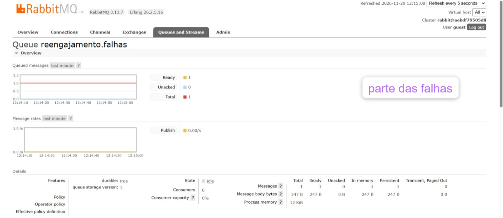

## 3. Observações

- O serviço de notificações foi testado isoladamente: as solicitações foram publicadas manualmente na fila. A publicação pelo Acompanhamento será registrada quando integrada.
- Cada solicitação tem no máximo 3 tentativas, com 30 s de espera entre elas.